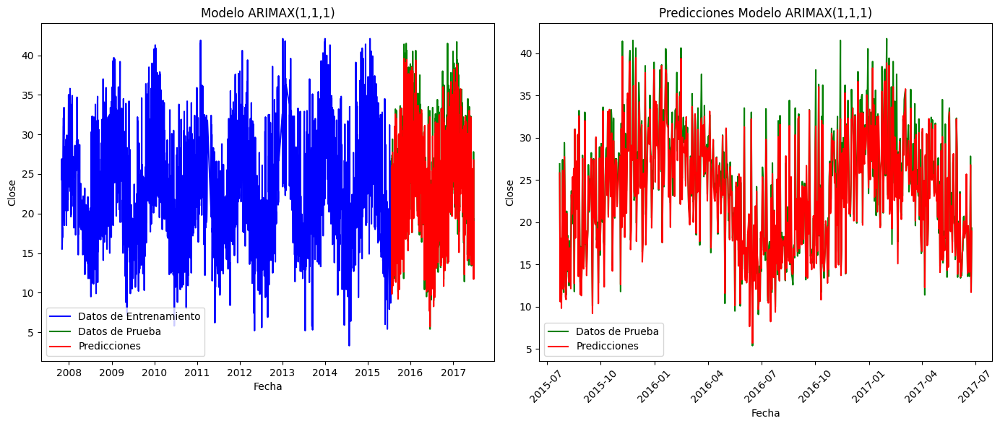
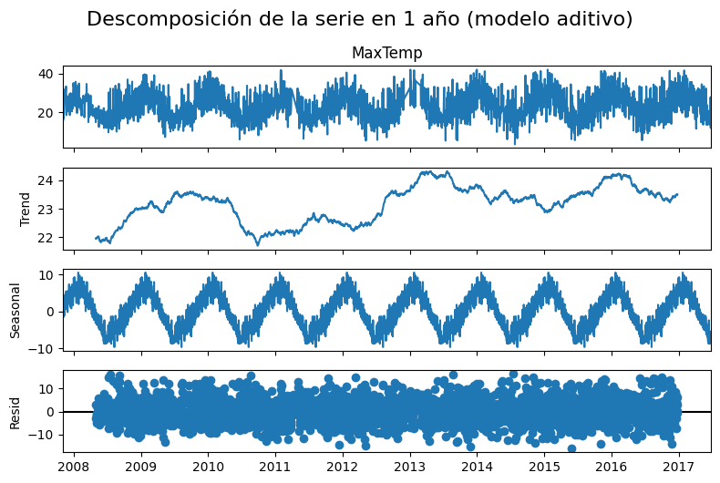

# Predicción de la temperatura máxima con series de tiempo

[](https://colab.research.google.com/github/CesarGuarecuco/Final-Time-Series-weatherAUS/blob/main/series_tiempo_weatherAUS.ipynb) [](https://nbviewer.org/github/CesarGuarecuco/Final-Time-Series-weatherAUS/blob/main/series_tiempo_weatherAUS.ipynb)

Proyecto académico (2024). Compara 10 modelos para predecir la temperatura máxima diaria (`MaxTemp`) con 10 años de datos del clima de Australia: siete modelos estadísticos y tres redes neuronales recurrentes.

## Resultado

Los modelos que usan variables externas (ARIMAX y SARIMAX) y las tres redes neuronales explican alrededor del 95% de la variación de la temperatura, con un error medio cercano a 1 °C. Los modelos que solo miran la propia serie (AR, MA, ARIMA, SARIMA) no sirven para esta variable: su R² es bajo o negativo.

| Modelo | MAE (°C) | RMSE (°C) | R² |
| --- | --- | --- | --- |
| AR | 4,60 | 5,81 | 0,33 |
| MA | 5,94 | 7,17 | −0,02 |
| ARMA | 6,13 | 7,47 | −0,11 |
| ARIMA | 8,45 | 10,37 | −1,14 |
| SARIMA | 9,06 | 11,00 | −1,41 |
| **ARIMAX** | **1,05** | 1,67 | 0,94 |
| SARIMAX | 2,09 | 2,58 | 0,87 |
| SimpleRNN | 1,08 | **1,62** | **0,95** |
| LSTM | 1,14 | 1,73 | 0,94 |
| GRU | 1,14 | 1,73 | 0,95 |



## Qué incluye el notebook

1. Análisis exploratorio y tratamiento de valores atípicos.
2. Descomposición de la serie (tendencia y estacionalidad), autocorrelación y prueba de estacionariedad.
3. Modelos AR, MA, ARMA, ARIMA, SARIMA, ARIMAX y SARIMAX con statsmodels.
4. Redes SimpleRNN, LSTM y GRU con Keras.
5. Comparación de métricas y análisis de residuos (normalidad, autocorrelación).



## Datos

Dataset público [Rain in Australia](https://www.kaggle.com/datasets/jsphyg/weather-dataset-rattle-package) de Kaggle. No se incluye en el repositorio: descarga `weatherAUS.csv` y déjalo junto al notebook.

## Cómo ejecutarlo

```bash
pip install -r requirements.txt
jupyter notebook series_tiempo_weatherAUS.ipynb
```

O ábrelo en Colab con el botón de arriba y sube `weatherAUS.csv`.

---

¿Necesitas un análisis o un modelo como este con los datos de tu organización? [Sivax Intelligence](https://sivax-intelligent.netlify.app/) · [sivax.contacto@gmail.com](mailto:sivax.contacto@gmail.com)
